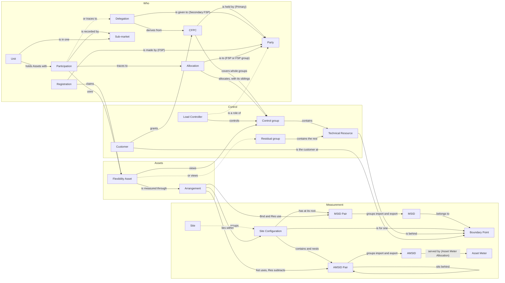
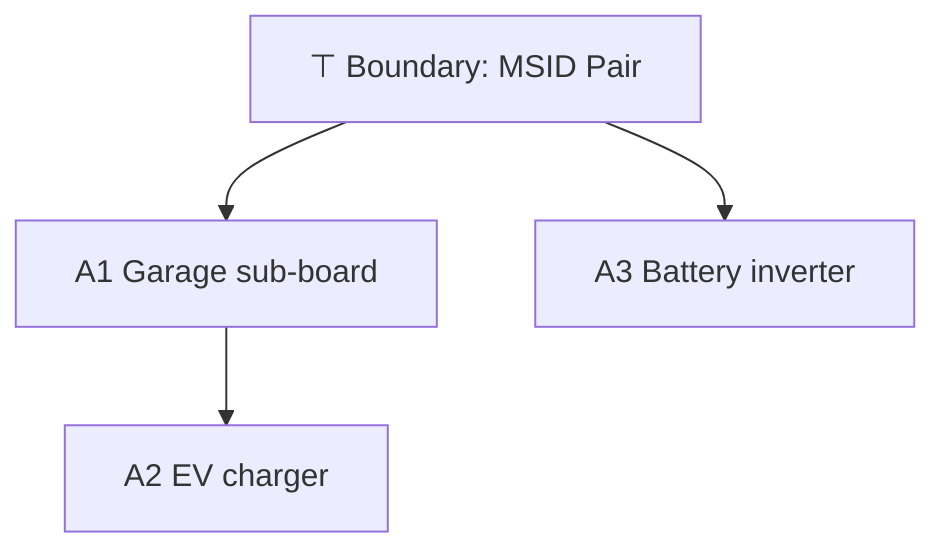
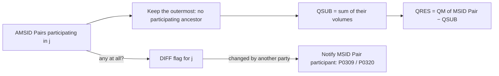

# Flexibility Core Model – Draft v0.3

> **Status:** Draft v0.3 for review (2026-11-20). Not BSC text.  
> **What it is:** the 99 consolidated statements (CAA relationships, the BSC Site Configuration proposal and the control layer) written as a core set of expressions, in notation aligned with BSC Annex X-2.  
> **Companion:** `Flexibility Core Model.html` shows the same model visually: a notation guide, an interactive knowledge graph, a section-by-section walkthrough, a metering-tree explorer and a differencing timeline.  
> **Source of truth:** `model.py`. Both files are generated by `build.py`; edit `model.py` and rebuild rather than editing this file.  
> **Earlier work:** supersedes `work/Flexibility Asset Notation - Draft v0.2.md` for these statements; v0.2 stays as the record of the earlier statement set.

---

## Choices behind the model

1. Logical metering identities (MSID, AMSID) are the keys for measurement. Physical meters attach through Asset Meter Allocation, so replacing a meter changes nothing above it.
2. The Site Configuration is the scope for measurement and compatibility. The Site is a grouping only.
3. The TR control group is the unique object of flexibility. An Asset is that group seen through one measurement arrangement, so one group can have several sibling Assets.
4. Differencing is derived in the BSC, but the residual Asset is still an explicit FMAR object.
5. “Who” has two levels. Allocation is cross-market and held in FMAR. Participation is per sub-market. Every participation must trace back to an allocation.

## Reading the notation

You don’t need a maths background to read this model. It uses a handful of symbols from set notation, which is mostly the language of lists, lookups and true/false tests. Each symbol is introduced again, in plain words, in the section where it is first needed.

| Symbol | Say it as | Think of it as | Example | Reads |
|---|---|---|---|---|
| $`\{\ \}`$ | the set of … | A list with no duplicates and no order, like the rows of a register. | $`\{\mathrm{EV},\ \mathrm{Freezer}\}`$ | the set holding the EV and the freezer |
| $`\mathcal{R},\ r`$ | all the TRs; one TR | A curly capital names the whole collection (the table); a small letter is one member (a row). | $`r \in \mathcal{R}`$ | r is one of the TRs |
| $`\in,\ \notin`$ | is in; is not in | Membership, like x in list in code. | $`\mathrm{EV} \in g`$ | the EV is in group g |
| $`\subseteq,\ \subsetneq`$ | is contained in; is contained in, with room to spare | Every member of the left is also on the right. | $`\operatorname{reach}(A_2) \subseteq \operatorname{reach}(A_1)`$ | everything A2 measures, A1 measures too |
| $`\cup`$ | together with (union) | Combine two lists and drop duplicates; a logical OR on membership. | $`g \cup g'`$ | every TR in g or in g′ |
| $`\cap`$ | in both (intersection) | Keep only what appears in both lists. An empty result means no clash. | $`\operatorname{per}(x) \cap \operatorname{per}(x') = \varnothing`$ | the two perimeters share no TR |
| $`\setminus`$ | minus (take away) | Remove the members of the right-hand list from the left. | $`\mathcal{R}_b \setminus \operatorname{reach}(A)`$ | everything behind b except what A measures |
| $`\varnothing`$ | the empty set | A list with nothing in it. | $`E(a) = \varnothing`$ | the Asset has no exposure |
| $`\sqcup`$ | split into (disjoint union) | A union where the pieces share nothing: a partition, like sorting items into bins. | $`\mathcal{R}_b = R_b \sqcup g_1 \sqcup g_2`$ | every TR at b is in exactly one of: the residual group, g1, g2 |
| $`f(x)`$ | f of x | A lookup: give it x, get exactly one answer back, like a keyed column or VLOOKUP. | $`\operatorname{LC}(r, t) = p`$ | the Load Controller of TR r at time t is party p |
| $`QM_{Kj}`$ | QM for K in j | Subscripts are keys. This is the BSC style: the quantity QM, keyed by K and j. | $`QM_{A_1, 5}`$ | the metered volume of A1 in Settlement Period 5 |
| $`(a, b, c)`$ | a record of a, b and c | A tuple: a record whose fields come in a fixed order. | $`a = (g, x)`$ | an Asset is the record (group, arrangement) |
| $`[P]`$ | 1 if P is true, else 0 | A Boolean turned into a number, so it can be added up. | $`[\operatorname{loc}(r,t) = b]`$ | 1 if r is behind b at t, otherwise 0 |
| $`\sum`$ | add up over … | A SUM over a filtered column. Adding up indicators counts things. | $`\sum_{b} [\operatorname{loc}(r,t) = b] \le 1`$ | count the Boundary Points r is behind: at most one |
| $`\forall,\ \exists,\ \exists!,\ \nexists`$ | for every; there is at least one; there is exactly one; there is none | Loops and searches: for every row; some row matches; exactly one row matches; no row matches. | $`\forall r \in g:\ \operatorname{LC}(r,t) = p`$ | every TR in g has Load Controller p |
| $`\land,\ \lor,\ \neg`$ | and; or; not | Logical AND, OR, NOT. | $`A \not\sqsubseteq A' \land A' \not\sqsubseteq A`$ | neither sits behind the other |
| $`\Rightarrow,\ \iff`$ | if … then; exactly when | An implication (a rule that must hold) and a two-way equivalence (a definition or test). | $`\operatorname{incl}(a) \iff E(a) \ne \varnothing`$ | an Asset is inclusive exactly when its exposure set is not empty |
| $`[t_1, t_2)`$ | from t1, up to but not including t2 | Effective-from is included, effective-to is not, so one record can end at the instant the next begins. | $`I(\lambda) = [t_0, t^{*})`$ | allocation λ runs from t0 until t* |
| $`A \sqsubset A'`$ | A sits behind A′ | A symbol from this model: A′ is upstream of A in the metering tree. ⊑ also allows A = A′. | $`A_2 \sqsubset A_1`$ | the EV charger meter sits behind the garage sub-board meter |

BSC symbols are kept where they already exist: K for a metering identity (Table X-4), j for a Settlement Period, i2 for a Secondary BM Unit and p for a party. Volumes keep the BSC’s run-together form, e.g. $`QM_{Kj}`$. Each expression has an ID: D for definitions, E for rules and derived results, V for volumes, O for open items and objectives.

## Knowledge graph

The key objects and how they relate. The HTML version is interactive: select a node to see its definition, symbol and statements.



## The core on one page

These expressions carry the structure. Everything else in the model is detail on top of them.

**E3 · Meter replacement is invisible above the identity** [Derived] · statements 12

```math
\begin{gathered} \operatorname{AMA}(K, t_1) \ne \operatorname{AMA}(K, t_2) \\ \text{changes no expression below, since none takes } m \text{ as an argument} \end{gathered}
```

Everything in sections 3 to 12 is keyed on K, never on m (choice 1).

**D4 · Site Configuration record** [Def] · statements 13

```math
\begin{gathered}
c = \big(\operatorname{id}(c),\ b_c,\ \mathcal{K}^{M}_c,\ \mathcal{A}_c,\ \operatorname{par}_c,\ I(c)\big) \\
\mathcal{K}^{M}_c \subseteq \operatorname{bp}^{-1}(b_c)
\end{gathered}
```

Which MSIDs (at one Boundary Point), which AMSID Pairs, and how they nest (par_c).

**D5 · Metering tree** [Def] · statements 17

```math
\begin{gathered}
\operatorname{par}_c : \mathcal{A}_c \to \mathcal{A}_c \cup \{\top_c\}, \quad \top_c = M_{b_c}, \quad \text{acyclic} \\
A \sqsubset A' \iff A' \text{ is reached by repeating } \operatorname{par}_c \text{ from } A
\end{gathered}
```

The root ⊤ is the boundary. ⊑ is ⊏ or equal.

**D8 · Control group** [Def] · statements 24

```math
\begin{gathered}
\varnothing \ne g \subseteq \mathcal{R}_{b,t} \\
\forall r \in g:\ \operatorname{LC}(r,t) = \operatorname{LC}(g,t) \\
\operatorname{one}(g,t)
\end{gathered}
```

one(g,t): the Load Controller can instruct g as one. 𝒢_{b,t} is the set of control groups at b.

**E12 · Groups and residual partition the Boundary Point** [Derived] · statements 27

```math
\mathcal{R}_{b,t} = R_{b,t}\ \sqcup \bigsqcup_{g \in \mathcal{G}_{b,t}} g
```

⊔ is a union of sets with no TR in common.

**E13 · Who may offer a control group** [Rule] · statements 28

```math
\operatorname{offers}(p, g, t) \Rightarrow p = \operatorname{LC}(g,t)\ \lor\ \operatorname{agr}\big(p, \operatorname{LC}(g,t), t\big)
```

agr = a control agreement.

**E18 · Side-by-side meters reach different TRs** [Rule] · statements 34

```math
A \not\sqsubseteq A' \ \land\ A' \not\sqsubseteq A \ \Rightarrow\ \operatorname{reach}_t(A) \cap \operatorname{reach}_t(A') = \varnothing
```

With E17 the reaches nest like boxes inside boxes (a laminar family): any two are nested or disjoint.

**D11 · Three kinds of arrangement** [Def] · statements 35

```math
\mathcal{X}_c = \{\mathrm{Bnd}\}\ \cup\ \{\mathrm{Ast}(A) : A \in \mathcal{A}_c\}\ \cup\ \{\mathrm{Res}(X) : \varnothing \ne X \subseteq \mathcal{A}_c\}
```

Boundary, Asset and Residual. X is the set of AMSID Pairs subtracted.

**D12 · Measurement perimeter** [Def] · statements 36

```math
\begin{aligned} \operatorname{per}_t(\mathrm{Bnd}) &= \operatorname{reach}_t(M_b) \\ \operatorname{per}_t(\mathrm{Ast}(A)) &= \operatorname{reach}_t(A) \\ \operatorname{per}_t(\mathrm{Res}(X)) &= \operatorname{reach}_t(M_b) \setminus \bigcup_{A \in X} \operatorname{reach}_t(A) \end{aligned}
```

**D13 · Flexibility Asset** [Def] · statements 40

```math
\begin{gathered}
a = (g, x) \\
g \in \mathcal{G}_{b,t} \cup \{R_{b,t}\},\ \ x \in \mathcal{X}_c,\ \ b_c = b,\ \operatorname{live}_t(c) \\
\operatorname{grp}(a) = g,\ \operatorname{arr}(a) = x
\end{gathered}
```

𝓕_c is the set of Assets in c.

**E23 · Compensation effect** [Derived] · statements 44

```math
\begin{gathered}
QMA_{\operatorname{arr}(a),j} = \underbrace{\sum_{r \in \operatorname{grp}(a)} QTR_{rj}}_{\text{delivered}} + \underbrace{\sum_{r \in E(a)} QTR_{rj}}_{\text{exposure}} \\
\operatorname{incl}(a) \iff E(a) \ne \varnothing
\end{gathered}
```

From V2: the exposure term can counteract delivery.

**E25 · Siblings never share a sub-market** [Rule] · statements 47

```math
\begin{gathered}
\sum_{a :\ \operatorname{grp}(a) = g} \big[\operatorname{part}(a, s, t)\big] \le 1 \\
\forall g, s, t
\end{gathered}
```

**D18 · Overlap** [Def] · statements 50

```math
\operatorname{ov}_t(a, a') \iff \operatorname{grp}(a) \ne \operatorname{grp}(a')\ \land\ \operatorname{per}_t(\operatorname{arr}(a)) \cap \operatorname{per}_t(\operatorname{arr}(a')) \ne \varnothing
```

**E29 · Overlap from the metering tree alone** [Derived] · statements 54, 55, 56, 57

```math
\operatorname{ov}^{\mathrm{tree}}(x, x') = \begin{cases} 1 & x = \mathrm{Bnd}\ \text{or}\ x' = \mathrm{Bnd}\ \text{or}\ x = x' \\ [A \sqsubseteq A' \lor A' \sqsubseteq A] & x = \mathrm{Ast}(A),\ x' = \mathrm{Ast}(A') \\ 1 - [\exists A'' \in X : A \sqsubseteq A''] & x = \mathrm{Ast}(A),\ x' = \mathrm{Res}(X) \\ 1 & x = \mathrm{Res}(X),\ x' = \mathrm{Res}(X')\ ^{\dagger} \end{cases}
```

† unless the subtracted meters together reach every TR, which the tree alone cannot show; treated as overlapping. Statement 55 omits the case A = A′; statement 57 covers it.

**D20 · Compatibility** [Def] · statements 59

```math
\operatorname{compat}(c, t) \iff \forall a, a' \in \mathcal{F}_c:\ \operatorname{inUse}_t(a) \land \operatorname{inUse}_t(a') \Rightarrow \neg\operatorname{ov}_t(a, a')
```

**E34 · A CFPC covers whole groups** [Rule] · statements 69

```math
\begin{gathered}
\operatorname{trs}(\varphi) \cap g \in \{\varnothing,\ g\} \\
\forall g \in \mathcal{G}_{b_\varphi, t}
\end{gathered}
```

**D28 · Allocation (to the group)** [Def] · statements 79

```math
\begin{gathered}
\lambda = \big(g_\lambda,\ F_\lambda \subseteq \mathcal{P},\ I(\lambda)\big) \\
\operatorname{alloc}(a, t) = \lambda \iff \operatorname{grp}(a) = g_\lambda \land \operatorname{live}_t(\lambda)
\end{gathered}
```

One allocation covers all of [g] (E26).

**E40 · At most one allocation per group** [Rule] · statements 81

```math
\sum_{\lambda} \big[g_\lambda = g\big]\big[\operatorname{live}_t(\lambda)\big] \le 1
```

**E41 · Every participation traces to an allocation** [Rule] · statements 84

```math
\begin{aligned} \forall \pi:\ & \exists!\, \lambda:\ g_\lambda = \operatorname{grp}(a_\pi),\ \operatorname{fsp}(\pi) \in F_\lambda,\ I(\pi) \subseteq I(\lambda) \\ \text{or}\ & \exists \delta:\ \operatorname{sec}(\delta) = \operatorname{fsp}(\pi),\ s_\delta = s_\pi,\ I(\pi) \subseteq I(\delta) \end{aligned}
```

The delegation route is finding F6.

**E45 · When an MSID Pair is differenced** [Rule] · statements 88

```math
\mathrm{DIFF}_{cj} = \Big[\, \exists A \in \mathcal{A}_c:\ \operatorname{part}^{\mathrm{BSC}}(A, j) \,\Big]
```

part^BSC(A, j): A has a live AMSID Pair Allocation in Settlement Period j.

**E46 · Subtract only the outermost participating AMSIDs** [Derived] · statements 89

```math
\begin{aligned} \mathrm{PA}_{cj} &= \{A : \operatorname{part}^{\mathrm{BSC}}(A, j)\} \\ \mathrm{OUT}_{cj} &= \{A \in \mathrm{PA}_{cj} : \nexists A' \in \mathrm{PA}_{cj},\ A \sqsubset A'\} \\ QSUB_{cj} &= \sum_{A \in \mathrm{OUT}_{cj}} QM_{Aj} \end{aligned}
```

OUT is an antichain by construction, so E19 holds automatically and nothing is subtracted twice. Compare ΣKDiff in Table X-5.

**O1 · Avoided duplication** [Derived] · statements 96

```math
\begin{gathered}
\forall s, t, r:\ \sum_{g} \Big[\, \exists a \in [g]:\ \operatorname{part}(a,s,t)\ \land\ r \in \operatorname{per}_t(\operatorname{arr}(a)) \,\Big] \le 1 \\
\text{and E25}
\end{gathered}
```

Holds from E41 → E39 → D20 (no overlap in use), E9 (different Boundary Points are disjoint) and E25. Gaps: F4, F6.

## Notation register

| Symbol | Reads as | BSC alignment | Introduced in |
|---|---|---|---|
| $`t,\ \tau,\ j`$ | spot time; a period; a Settlement Period | t as Annex X-2 4.4; j as Tables X-1/X-4; j ∈ τ as j∈D in 1.2.1(b) | 1. Basic sets |
| $`b \in \mathcal{B}`$ | a Boundary Point | BSC Boundary Point | 1. Basic sets |
| $`K \in \mathcal{K}^{M} \cup \mathcal{K}^{A}`$ | a metering identity: an MSID or an AMSID | K, Table X-4 (SVA Metering System and/or Asset Metering System) | 1. Basic sets |
| $`m \in \mathcal{M}`$ | a physical Asset Meter | Asset Meter (BSCP603) | 1. Basic sets |
| $`r \in \mathcal{R}`$ | a Technical Resource (TR) | new (CAA) | 1. Basic sets |
| $`p \in \mathcal{P}`$ | a party | p, Table X-1 | 1. Basic sets |
| $`s \in \mathcal{S}`$ | a sub-market | new; BM and wholesale (WM) are members | 1. Basic sets |
| $`\operatorname{roles}(p,t)`$ | the roles party p holds at time t | new | 1. Basic sets |
| $`\operatorname{bp}(K)`$ | the Boundary Point an MSID belongs to | new | 2. Boundary points and metering identities |
| $`M_b`$ | the MSID Pair of Boundary Point b | MSID Pair (S10.1) | 2. Boundary points and metering identities |
| $`A \in \mathcal{A}`$ | an AMSID Pair | AMSID Pair (S10.1A) | 2. Boundary points and metering identities |
| $`\operatorname{AMA}(K,t)`$ | the Asset Meter serving AMSID K at t (Asset Meter Allocation) | new | 2. Boundary points and metering identities |
| $`c \in \mathcal{C}`$ | a Site Configuration | new: proposed BSC Site Configuration | 3. Site Configuration and the metering tree |
| $`I(e) = [\operatorname{from}(e), \operatorname{to}(e))`$ | the effective interval of a record e | effective from / to dates | 3. Site Configuration and the metering tree |
| $`\operatorname{live}_t(e) \iff t \in I(e)`$ | record e is in force at t | new | 3. Site Configuration and the metering tree |
| $`[P]`$ | 1 if statement P is true, else 0 | indicator, as BSC 1/0 indicators | 3. Site Configuration and the metering tree |
| $`\operatorname{par}_c(A),\ \top_c`$ | the parent of A in the metering tree of c; the root (the boundary) | new | 3. Site Configuration and the metering tree |
| $`A \sqsubset A',\ A \sqsubseteq A'`$ | A sits behind A′; A is A′ or sits behind it | new | 3. Site Configuration and the metering tree |
| $`w \in \mathcal{W}`$ | a Site (a set of Site Configurations) | new | 3. Site Configuration and the metering tree |
| $`\operatorname{loc}(r,t)`$ | the Boundary Point that TR r is behind at t | new | 4. TRs and control |
| $`\mathcal{R}_{b,t}`$ | the TRs behind b at t | new | 4. TRs and control |
| $`\operatorname{LC}(r,t),\ \mathrm{ACT}_t`$ | the Load Controller of r at t; the actively controlled TRs | new | 4. TRs and control |
| $`g \in \mathcal{G}_{b,t}`$ | a TR control group at b | new (CAA) | 4. TRs and control |
| $`R_{b,t}`$ | the residual group at b | new | 4. TRs and control |
| $`\succ_{g,t}`$ | the agreed order of precedence among FSPs offering g | new | 4. TRs and control |
| $`\operatorname{cust}(b,t)`$ | the customer at b | new | 4. TRs and control |
| $`\operatorname{reach}_t(K)`$ | the TRs whose flow K records | new | 5. Reach and measurement arrangements |
| $`x \in \mathcal{X}_c:\ \mathrm{Bnd},\ \mathrm{Ast}(A),\ \mathrm{Res}(X)`$ | a measurement arrangement in c, of one of three kinds | new; Res(X) ≈ Asset Differencing, S10.1A.2(e)(ii) | 5. Reach and measurement arrangements |
| $`\operatorname{per}_t(x)`$ | the measurement perimeter of arrangement x | new | 5. Reach and measurement arrangements |
| $`QM_{Kj}`$ | net metered volume of identity or pair K in Settlement Period j (MWh, export positive) | BSC run-together form, 2.4.1 sign convention | 5. Reach and measurement arrangements |
| $`a = (g, x),\ \operatorname{grp}(a),\ \operatorname{arr}(a)`$ | a Flexibility Asset, its group and its arrangement | new (CAA) | 6. Assets |
| $`E_t(a)`$ | the exposure set: TRs in the perimeter but outside the group | new | 6. Assets |
| $`a \sim a',\ [g]`$ | a and a′ are siblings; all the Assets of group g | new | 6. Assets |
| $`\operatorname{ov}_t(a,a'),\ \operatorname{ov}^{\mathrm{tree}}`$ | a and a′ overlap; overlap read from the metering tree | new | 7. Overlap, compatibility and consolidation |
| $`\operatorname{compat}(c,t)`$ | configuration c is compatible at t | new | 7. Overlap, compatibility and consolidation |
| $`\varphi,\ \delta`$ | a CFPC, a delegation | new | 8. Authority and delegation |
| $`\kappa,\ \lambda,\ \pi`$ | a registration, an allocation, a participation | new; π in the BSC is an MSID or AMSID Pair Allocation | 9. Registration, allocation and participation |
| $`\operatorname{part}(a,s,t)`$ | Asset a is participating in sub-market s at t | new | 9. Registration, allocation and participation |
| $`\mathrm{DIFF}_{cj},\ \mathrm{OUT}_{cj}`$ | is the MSID Pair differenced in j; the outermost participating AMSID Pairs | new; compare ΣKDiff, Table X-5 | 10. Differencing in the BSC |
| $`u`$ | a Unit | Secondary BM Unit i2 in the BSC (Table X-4) | 11. Units |

## The statements, section by section

### 1. Basic sets

The model starts by naming the kinds of thing it talks about. Each kind is a set: a collection with no duplicates, like the rows of a register. A curly capital names the collection, and a small letter is one member of it.

**New symbols in this section**

| Symbol | Reads as |
|---|---|
| $`t,\ \tau,\ j`$ | spot time; a period; a Settlement Period |
| $`b \in \mathcal{B}`$ | a Boundary Point |
| $`K \in \mathcal{K}^{M} \cup \mathcal{K}^{A}`$ | a metering identity: an MSID or an AMSID |
| $`m \in \mathcal{M}`$ | a physical Asset Meter |
| $`r \in \mathcal{R}`$ | a Technical Resource (TR) |
| $`p \in \mathcal{P}`$ | a party |
| $`s \in \mathcal{S}`$ | a sub-market |
| $`\operatorname{roles}(p,t)`$ | the roles party p holds at time t |

| # | Tag | Statement | Expressions |
|---|---|---|---|
| 1 | Def | There is a set of Boundary Points: points of connection to the network. | D1 |
| 2 | Def | There is a set of Metering Systems (MSIDs), which identify boundary metering. | D1 |
| 3 | Def | There is a set of Asset Metering Systems (AMSIDs), which identify asset metering. | D1 |
| 4 | Def | There is a set of Asset Meters: the physical devices. | D1 |
| 5 | Def | There is a set of Technical Resources (TRs). | D1 |
| 6 | Def | There is a set of parties. A party can hold one or more roles: Load Controller, FSP, CFPC holder (Primary), Secondary FSP, Supplier, or BSC Party operating BM Units. | D2 |
| 7 | Def | There are sets of customers, sub-markets and periods. The Balancing Mechanism and the wholesale market are sub-markets. | D1 |

**D1 · Universe of objects** [Def] · statements 1, 2, 3, 4, 5, 7

*Read it as:* These are the collections the model talks about: Boundary Points, MSIDs, AMSIDs, Asset Meters, TRs, parties, customers, sub-markets (the BM and wholesale among them) and periods.

```math
\mathcal{B},\ \mathcal{K}^{M},\ \mathcal{K}^{A},\ \mathcal{M},\ \mathcal{R},\ \mathcal{P},\ \mathcal{U},\ \mathcal{S} \ni \mathrm{BM}, \mathrm{WM},\ \mathcal{T}
```

Boundary Points, MSIDs, AMSIDs, Asset Meters, TRs, parties, customers, sub-markets, periods.

**D2 · Roles are time-dependent** [Def] · statements 6

*Read it as:* Look up a party p at time t and you get the roles it holds then: Load Controller, FSP, Primary, Secondary FSP, Supplier or BM Unit operator.

```math
\operatorname{roles}(p,t) \subseteq \{\mathrm{LC},\ \mathrm{FSP},\ \mathrm{PRI},\ \mathrm{SEC},\ \mathrm{SUP},\ \mathrm{BMP}\}
```

Load Controller, FSP, CFPC holder (Primary), Secondary FSP, Supplier, BSC Party operating BM Units.

### 2. Boundary points and metering identities

Boundary metering is identified by MSIDs, and asset metering by AMSIDs. These logical identities, not the physical meters, are what the rest of the model refers to. A physical Asset Meter attaches to an AMSID through an Asset Meter Allocation, so replacing a meter changes nothing above it.

**New symbols in this section**

| Symbol | Reads as |
|---|---|
| $`\operatorname{bp}(K)`$ | the Boundary Point an MSID belongs to |
| $`M_b`$ | the MSID Pair of Boundary Point b |
| $`A \in \mathcal{A}`$ | an AMSID Pair |
| $`\operatorname{AMA}(K,t)`$ | the Asset Meter serving AMSID K at t (Asset Meter Allocation) |

| # | Tag | Statement | Expressions |
|---|---|---|---|
| 8 | Rule | Each MSID belongs to exactly one Boundary Point. | E1 |
| 9 | Def | An MSID Pair is a BSC process construct grouping a Boundary Point’s import MSID with its export MSID, if there is one. | D3 |
| 10 | Def | An AMSID Pair groups an import AMSID with its export AMSID, if there is one, measuring the same equipment. | D3 |
| 11 | Rule | Each AMSID is served by exactly one Asset Meter at any time, recorded as an Asset Meter Allocation. | E2 |
| 12 | Derived | Replacing a physical Asset Meter changes its Asset Meter Allocation, not the AMSID. | E3 |

**E1 · Each MSID belongs to one Boundary Point** [Rule] · statements 8

*Read it as:* bp is a lookup from MSID to Boundary Point. Because it is a lookup, each MSID gives exactly one answer.

```math
\operatorname{bp} : \mathcal{K}^{M} \to \mathcal{B}
```

A function: exactly one Boundary Point per MSID.

**D3 · Pairs** [Def] · statements 9, 10

*Read it as:* An MSID Pair is the Boundary Point’s import MSID plus its export MSID, if there is one. An AMSID Pair is the same idea for asset metering.

```math
\begin{gathered}
M_b = \big(K^{M}_{\mathrm{imp}},\ K^{M}_{\mathrm{exp}}\big) \\
A = \big(K^{A}_{\mathrm{imp}},\ K^{A}_{\mathrm{exp}}\big) \\
K_{\mathrm{exp}} \text{ optional}
\end{gathered}
```

An AMSID Pair measures one piece of equipment, so its two identities share one reach (D10).

**E2 · Asset Meter Allocation** [Rule] · statements 11

*Read it as:* AMA is a lookup: give it an AMSID and a time, and it returns the one physical Asset Meter serving that AMSID then.

```math
\operatorname{AMA} : \mathcal{K}^{A} \times t \to \mathcal{M}
```

A total function in time: exactly one Asset Meter serves each AMSID at any t.

**E3 · Meter replacement is invisible above the identity** [Derived] · statements 12

*Read it as:* If the meter serving AMSID K changes between two times, nothing else in the model changes, because nothing else refers to the physical meter.

```math
\begin{gathered} \operatorname{AMA}(K, t_1) \ne \operatorname{AMA}(K, t_2) \\ \text{changes no expression below, since none takes } m \text{ as an argument} \end{gathered}
```

Everything in sections 3 to 12 is keyed on K, never on m (choice 1).

### 3. Site Configuration and the metering tree

A Site Configuration is the BSC record that says which MSIDs and AMSIDs belong together at one Boundary Point, and how the AMSIDs nest. The nesting forms the metering tree, with the boundary at the root. Any change of contents makes a new configuration with a new ID.

**New symbols in this section**

| Symbol | Reads as |
|---|---|
| $`c \in \mathcal{C}`$ | a Site Configuration |
| $`I(e) = [\operatorname{from}(e), \operatorname{to}(e))`$ | the effective interval of a record e |
| $`\operatorname{live}_t(e) \iff t \in I(e)`$ | record e is in force at t |
| $`[P]`$ | 1 if statement P is true, else 0 |
| $`\operatorname{par}_c(A),\ \top_c`$ | the parent of A in the metering tree of c; the root (the boundary) |
| $`A \sqsubset A',\ A \sqsubseteq A'`$ | A sits behind A′; A is A′ or sits behind it |
| $`w \in \mathcal{W}`$ | a Site (a set of Site Configurations) |

| # | Tag | Statement | Expressions |
|---|---|---|---|
| 13 | Def | A Site Configuration is an effective-dated record with an immutable ID, stating three things: which MSIDs at one Boundary Point are related; which AMSIDs are related to them; how those AMSIDs are nested. | D4 |
| 14 | Rule | Each Boundary Point has at most one effective Site Configuration at any time. | E4 |
| 15 | Rule | Each AMSID belongs to exactly one effective Site Configuration at any time. | E5 |
| 16 | Rule | Any change to the MSIDs, the AMSIDs or their nesting creates a new Site Configuration with a new ID, replacing the old one from its effective date. | E6 |
| 17 | Def | The metering tree of a Site Configuration has the Boundary Point’s MSIDs at its root. Each AMSID has exactly one parent: either the boundary, or another AMSID it sits behind. | D5 |
| 18 | Def | A Site groups one or more Site Configurations. | D6 |
| 19 | Rule | Changing which Site a Site Configuration belongs to doesn’t create a new Site Configuration. | E7 |

**D4 · Site Configuration record** [Def] · statements 13

*Read it as:* A Site Configuration is a record with an ID, its Boundary Point, the MSIDs it relates (all at that Boundary Point), the AMSID Pairs it relates, each AMSID Pair’s parent (the nesting), and its effective dates.

```math
\begin{gathered}
c = \big(\operatorname{id}(c),\ b_c,\ \mathcal{K}^{M}_c,\ \mathcal{A}_c,\ \operatorname{par}_c,\ I(c)\big) \\
\mathcal{K}^{M}_c \subseteq \operatorname{bp}^{-1}(b_c)
\end{gathered}
```

Which MSIDs (at one Boundary Point), which AMSID Pairs, and how they nest (par_c).

**E4 · At most one live configuration per Boundary Point** [Rule] · statements 14

*Read it as:* For a Boundary Point at a given time, count the configurations that belong to it and are live. The count is at most one.

```math
\sum_{c} \big[b_c = b\big]\,\big[\operatorname{live}_t(c)\big] \le 1
```

**E5 · Each AMSID in exactly one live configuration** [Rule] · statements 15

*Read it as:* For any AMSID at any time, count the live configurations that contain it. The count is exactly one.

```math
\begin{gathered}
\sum_{c} \big[K \in \mathcal{A}_c\big]\,\big[\operatorname{live}_t(c)\big] = 1 \\
\forall K \in \mathcal{K}^{A}
\end{gathered}
```

K ∈ 𝒜_c means K is one of the identities of a pair in 𝒜_c.

**E6 · Content changes make a new configuration** [Rule] · statements 16

*Read it as:* A configuration’s contents never change while it is live. A change at time t* closes the old configuration at t* and opens a new one, with a new ID, at the same instant.

```math
\begin{gathered} \operatorname{content}(c) \text{ is constant on } I(c) \\ \text{a change at } t^{*} \Rightarrow \operatorname{to}(c) = t^{*} = \operatorname{from}(c'),\ \ \operatorname{id}(c') \ne \operatorname{id}(c) \end{gathered}
```

content(c) = (𝒦ᴹ_c, 𝒜_c, par_c).

**D5 · Metering tree** [Def] · statements 17

*Read it as:* par gives each AMSID Pair its parent: another AMSID Pair, or the boundary (⊤). Following parents always ends at the boundary, never in a loop. “A sits behind A′” means A′ is somewhere up that chain.

```math
\begin{gathered}
\operatorname{par}_c : \mathcal{A}_c \to \mathcal{A}_c \cup \{\top_c\}, \quad \top_c = M_{b_c}, \quad \text{acyclic} \\
A \sqsubset A' \iff A' \text{ is reached by repeating } \operatorname{par}_c \text{ from } A
\end{gathered}
```

The root ⊤ is the boundary. ⊑ is ⊏ or equal.

**D6 · Site** [Def] · statements 18

*Read it as:* A Site is just a set of Site Configurations. site(c, t) says which Site c belongs to at time t.

```math
\begin{gathered}
w \subseteq \mathcal{C} \\
\operatorname{site}(c, t) = w
\end{gathered}
```

**E7 · Moving a configuration between Sites keeps its ID** [Rule] · statements 19

*Read it as:* Moving a configuration to a different Site is not a change of contents, so it keeps its ID.

```math
\operatorname{site}(c, t_1) \ne \operatorname{site}(c, t_2) \ \not\Rightarrow\ \text{a new } c
```

site is not part of content(c), so E6 does not fire.

Example metering tree (the one used in the HTML explorer):



Here A2 ⊏ A1, while A1 and A3 sit side by side, so their reaches are disjoint (E18).

### 4. TRs and control

TRs are the devices behind a Boundary Point. Each actively controlled TR has one Load Controller and sits in exactly one control group. Everything else behind the Boundary Point forms the residual group, so the groups and the residual between them hold every TR exactly once.

**New symbols in this section**

| Symbol | Reads as |
|---|---|
| $`\operatorname{loc}(r,t)`$ | the Boundary Point that TR r is behind at t |
| $`\mathcal{R}_{b,t}`$ | the TRs behind b at t |
| $`\operatorname{LC}(r,t),\ \mathrm{ACT}_t`$ | the Load Controller of r at t; the actively controlled TRs |
| $`g \in \mathcal{G}_{b,t}`$ | a TR control group at b |
| $`R_{b,t}`$ | the residual group at b |
| $`\succ_{g,t}`$ | the agreed order of precedence among FSPs offering g |
| $`\operatorname{cust}(b,t)`$ | the customer at b |

| # | Tag | Statement | Expressions |
|---|---|---|---|
| 20 | Rule | Each TR is located behind exactly one Boundary Point at any time. | E8 |
| 21 | Rule | A mobile TR, such as an EV, may be behind different Boundary Points at different times, but behind at most one in any period. | E9 |
| 22 | Def | A control assignment links a TR to the party acting as its Load Controller for a period. | D7 |
| 23 | Rule | Each actively controlled TR has exactly one Load Controller at any time. | E10 |
| 24 | Def | A TR control group is a non-empty set of TRs, all behind the same Boundary Point, which share one Load Controller and can be instructed by it as one. | D8 |
| 25 | Rule | Each actively controlled TR belongs to exactly one control group at any time. | E11 |
| 26 | Def | The residual group of a Boundary Point is every TR behind it that isn’t in a control group. That includes appliances used through customer behaviour, which have no Load Controller. | D9 |
| 27 | Derived | The control groups and the residual group at a Boundary Point together cover every TR there, with no TR in two of them. | E12 |
| 28 | Rule | An FSP may offer flexibility from a control group only if it is the group’s Load Controller or has a control agreement with it. | E13 |
| 29 | Rule | Where several FSPs offer the same control group (options 1a and 1b), all their instructions reach it through its one Load Controller, which applies an agreed order of precedence. | E14 |
| 30 | Rule | Statements 28 and 29 don’t apply to a residual group. An FSP influences a residual group through the customer, not through a Load Controller. | E15 |

**E8 · A TR is behind at most one Boundary Point at a time** [Rule] · statements 20

*Read it as:* For a TR at a given time, count the Boundary Points it is behind. The count is at most one: zero for an EV on the road.

```math
\sum_{b} \big[\operatorname{loc}(r,t) = b\big] \le 1
```

Statement 20 says “exactly one”. Kept as “at most one”, as agreed for v0.1/v0.2, so that an EV in transit is behind none (finding F1).

**E9 · Mobile TRs: at most one Boundary Point per period** [Rule] · statements 21

*Read it as:* Over a whole period, a TR is behind at most one Boundary Point. The TRs behind b during the period are those behind b at any moment in it.

```math
\begin{gathered}
\sum_{b} \max_{t \in \tau} \big[\operatorname{loc}(r,t) = b\big] \le 1 \\
\mathcal{R}_{b,\tau} = \{\, r : \exists t \in \tau,\ \operatorname{loc}(r,t) = b \,\}
\end{gathered}
```

max as Annex X-2 1.2.1(e).

**D7 · Control assignment** [Def] · statements 22

*Read it as:* A control assignment records a TR, a party and dates. LC(r, t) looks up which party is the TR’s Load Controller at time t.

```math
\begin{gathered}
\operatorname{ca} = \big(r,\ p,\ I(\operatorname{ca})\big) \\
\operatorname{LC}(r,t) = p \iff \exists \operatorname{ca} = (r, p, \cdot) \text{ live at } t
\end{gathered}
```

**E10 · Exactly one Load Controller for a controlled TR** [Rule] · statements 23

*Read it as:* Count the Load Controllers of a TR at time t: exactly one if the TR is actively controlled, none if it is not.

```math
\sum_{p} \big[\operatorname{LC}(r,t) = p\big] = \big[\, r \in \mathrm{ACT}_t \,\big]
```

1 for an actively controlled TR, 0 otherwise.

**D8 · Control group** [Def] · statements 24

*Read it as:* A control group is a non-empty set of TRs behind one Boundary Point, all with the same Load Controller, which can instruct them as one.

```math
\begin{gathered}
\varnothing \ne g \subseteq \mathcal{R}_{b,t} \\
\forall r \in g:\ \operatorname{LC}(r,t) = \operatorname{LC}(g,t) \\
\operatorname{one}(g,t)
\end{gathered}
```

one(g,t): the Load Controller can instruct g as one. 𝒢_{b,t} is the set of control groups at b.

**E11 · Each controlled TR is in exactly one group** [Rule] · statements 25

*Read it as:* Each actively controlled TR behind b is in exactly one of b’s control groups.

```math
\begin{gathered}
\sum_{g \in \mathcal{G}_{b,t}} \big[r \in g\big] = 1 \\
\forall r \in \mathrm{ACT}_t \cap \mathcal{R}_{b,t}
\end{gathered}
```

**D9 · Residual group** [Def] · statements 26

*Read it as:* The residual group is everything behind b, with the control groups taken away.

```math
R_{b,t} = \mathcal{R}_{b,t} \setminus \bigcup_{g \in \mathcal{G}_{b,t}} g
```

By E11 these are exactly the TRs with no Load Controller.

**E12 · Groups and residual partition the Boundary Point** [Derived] · statements 27

*Read it as:* Every TR behind b lands in exactly one bucket: one control group, or the residual group.

```math
\mathcal{R}_{b,t} = R_{b,t}\ \sqcup \bigsqcup_{g \in \mathcal{G}_{b,t}} g
```

⊔ is a union of sets with no TR in common.

**E13 · Who may offer a control group** [Rule] · statements 28

*Read it as:* If party p offers group g, then p must be g’s Load Controller or have a control agreement with it.

```math
\operatorname{offers}(p, g, t) \Rightarrow p = \operatorname{LC}(g,t)\ \lor\ \operatorname{agr}\big(p, \operatorname{LC}(g,t), t\big)
```

agr = a control agreement.

**E14 · Several FSPs: one Load Controller, one order** [Rule] · statements 29

*Read it as:* If two or more parties offer the same group, every instruction goes through the group’s Load Controller, which ranks them by the agreed order.

```math
\begin{gathered} \big|\{p : \operatorname{offers}(p,g,t)\}\big| \ge 2 \Rightarrow \\ \text{every instruction to } g \text{ passes } \operatorname{LC}(g,t), \text{ ordered by } \succ_{g,t} \end{gathered}
```

≻_{g,t}: the agreed order of precedence (options 1a and 1b).

**E15 · The residual group is influenced through the customer** [Rule] · statements 30

*Read it as:* To offer the residual group, a party needs an agreement with the customer at that Boundary Point. The Load Controller rules do not apply.

```math
\begin{gathered}
\operatorname{offers}(p, R_{b,t}, t) \Rightarrow \operatorname{agr}\big(p, \operatorname{cust}(b,t), t\big) \\
\text{E13, E14 do not apply to } R_{b,t}
\end{gathered}
```

### 5. Reach and measurement arrangements

Each metering identity reaches a set of TRs. Reaches nest like boxes inside boxes: a meter sees everything a meter behind it sees, and meters side by side see different TRs. An arrangement combines identities to measure a perimeter: the boundary alone, one AMSID Pair, or the boundary minus some AMSID Pairs.

**New symbols in this section**

| Symbol | Reads as |
|---|---|
| $`\operatorname{reach}_t(K)`$ | the TRs whose flow K records |
| $`x \in \mathcal{X}_c:\ \mathrm{Bnd},\ \mathrm{Ast}(A),\ \mathrm{Res}(X)`$ | a measurement arrangement in c, of one of three kinds |
| $`\operatorname{per}_t(x)`$ | the measurement perimeter of arrangement x |
| $`QM_{Kj}`$ | net metered volume of identity or pair K in Settlement Period j (MWh, export positive) |

| # | Tag | Statement | Expressions |
|---|---|---|---|
| 31 | Def | The reach of a metering identity is the set of TRs whose energy flow it records. | D10 |
| 32 | Rule | The reach of a Boundary Point’s MSIDs is every TR behind that Boundary Point. | E16 |
| 33 | Rule | The reach of an AMSID is contained within the reach of its parent in the metering tree. | E17 |
| 34 | Rule | Two AMSIDs in the same metering tree, neither of which sits behind the other, have reaches with no TR in common. | E18 |
| 35 | Def | A measurement arrangement lies within one Site Configuration and has one of three types: Boundary: the MSID Pair alone; Asset: one AMSID Pair; Residual: the MSID Pair, net of one or more AMSID Pairs (differencing). | D11, V1 |
| 36 | Def | The measurement perimeter of an arrangement depends on its type: Boundary: the reach of the MSIDs; Asset: the reach of the AMSID; Residual: the reach of the MSIDs, minus the combined reach of the AMSIDs it subtracts. | D12, V1 |
| 37 | Rule | The AMSIDs a Residual arrangement subtracts must have reaches with no TR in common, so that no nested meter is subtracted twice. | E19, V2 |
| 38 | Rule | A Residual arrangement can exist only if at least one Asset arrangement in the same Site Configuration is in use. | E20 |
| 39 | Rule | Residual arrangements are accepted only in sub-markets that accept differencing. Today that’s the Balancing Mechanism and the wholesale market, for AMVLPs under P375. | E21 |

**D10 · Reach** [Def] · statements 31

*Read it as:* reach(K) is the set of TRs whose energy flow passes through metering identity K. Both identities of an AMSID Pair have the same reach.

```math
\begin{gathered}
\operatorname{reach}_t(K) \subseteq \mathcal{R} \\
\operatorname{reach}_t(A) = \operatorname{reach}_t(K^{A}_{\mathrm{imp}}) = \operatorname{reach}_t(K^{A}_{\mathrm{exp}})
\end{gathered}
```

**E16 · The boundary reaches everything behind it** [Rule] · statements 32

*Read it as:* The MSID Pair reaches every TR behind its Boundary Point.

```math
\operatorname{reach}_t(M_b) = \mathcal{R}_{b,t}
```

**E17 · A child reaches less than its parent** [Rule] · statements 33

*Read it as:* An AMSID Pair reaches nothing that its parent does not also reach.

```math
\operatorname{reach}_t(A) \subseteq \operatorname{reach}_t\big(\operatorname{par}_c(A)\big)
```

**E18 · Side-by-side meters reach different TRs** [Rule] · statements 34

*Read it as:* If neither of two AMSID Pairs sits behind the other, they share no TR. With E17 this means any two reaches are either nested or separate.

```math
A \not\sqsubseteq A' \ \land\ A' \not\sqsubseteq A \ \Rightarrow\ \operatorname{reach}_t(A) \cap \operatorname{reach}_t(A') = \varnothing
```

With E17 the reaches nest like boxes inside boxes (a laminar family): any two are nested or disjoint.

**D11 · Three kinds of arrangement** [Def] · statements 35

*Read it as:* In a configuration there are three kinds of arrangement: Bnd (the MSID Pair alone), Ast(A) (one AMSID Pair) and Res(X) (the MSID Pair minus a set X of AMSID Pairs).

```math
\mathcal{X}_c = \{\mathrm{Bnd}\}\ \cup\ \{\mathrm{Ast}(A) : A \in \mathcal{A}_c\}\ \cup\ \{\mathrm{Res}(X) : \varnothing \ne X \subseteq \mathcal{A}_c\}
```

Boundary, Asset and Residual. X is the set of AMSID Pairs subtracted.

**D12 · Measurement perimeter** [Def] · statements 36

*Read it as:* The perimeter is what each arrangement measures. Bnd measures everything behind b. Ast(A) measures A’s reach. Res(X) measures everything behind b, minus the reach of each AMSID Pair in X.

```math
\begin{aligned} \operatorname{per}_t(\mathrm{Bnd}) &= \operatorname{reach}_t(M_b) \\ \operatorname{per}_t(\mathrm{Ast}(A)) &= \operatorname{reach}_t(A) \\ \operatorname{per}_t(\mathrm{Res}(X)) &= \operatorname{reach}_t(M_b) \setminus \bigcup_{A \in X} \operatorname{reach}_t(A) \end{aligned}
```

**E19 · A Residual subtracts an antichain** [Rule] · statements 37

*Read it as:* A Residual may only subtract AMSID Pairs that sit side by side, never one behind another. That is the same as saying their reaches share no TR.

```math
\mathrm{Res}(X) \in \mathcal{X}_c \Rightarrow \forall A \ne A' \in X:\ A \not\sqsubset A' \iff \operatorname{reach}_t(A) \cap \operatorname{reach}_t(A') = \varnothing
```

By E17 and E18, “no two nested” and “no TR in common” say the same thing.

**E20 · A Residual needs an Asset arrangement in use** [Rule] · statements 38

*Read it as:* A Residual can be in use only if some Asset arrangement in the same configuration is in use.

```math
\operatorname{inUse}_t(\mathrm{Res}(X)) \Rightarrow \exists A \in \mathcal{A}_c:\ \operatorname{inUse}_t(\mathrm{Ast}(A))
```

inUse_t(x): some Asset with arrangement x has a live participation at t (finding F3).

**E21 · Residuals only where differencing is accepted** [Rule] · statements 39

*Read it as:* An Asset using a Residual arrangement can only take part in a sub-market that accepts differencing: today the BM and wholesale.

```math
\operatorname{arr}(a) = \mathrm{Res}(X)\ \land\ \operatorname{part}(a, s, t) \Rightarrow s \in \mathcal{S}^{\mathrm{DIFF}} = \{\mathrm{BM}, \mathrm{WM}\}
```

Today: AMVLPs under P375.

**V1 · Volume of an arrangement (BSC form)** [Def] · statements 35, 36

*Read it as:* The volume each arrangement measures in Settlement Period j. Bnd gives the MSID Pair’s volume; Ast(A) gives A’s volume; Res(X) gives the MSID Pair’s volume minus the volume of each AMSID Pair in X.

```math
\begin{gathered}
QMA_{\mathrm{Bnd},j} = QM_{M_b j} \\
QMA_{\mathrm{Ast}(A),j} = QM_{Aj} \\
QMA_{\mathrm{Res}(X),j} = QM_{M_b j} - \sum_{A \in X} QM_{Aj}
\end{gathered}
```

Signed sum of metered volumes, as AMMC_{Kj} = Σ_{KJ} AMRC_{KJj} in Annex S-2 3.5.3A.

**V2 · Volume matches perimeter** [Derived] · statements 37

*Read it as:* If each meter records the sum of the TRs it reaches, an arrangement’s volume is exactly the sum over the TRs in its perimeter, with no TR counted twice.

```math
QM_{Kj} = \sum_{r \in \operatorname{reach}(K)} QTR_{rj} \ \Rightarrow\ QMA_{x,j} = \sum_{r \in \operatorname{per}(x)} QTR_{rj}
```

Holds because of E19: no TR is subtracted twice. QTR_{rj} is the (unmetered) net flow of TR r.

### 6. Assets

An Asset is a group seen through one arrangement. The same group can be seen through several arrangements: these are sibling Assets, and they share one allocation. If the perimeter holds TRs outside the group, those TRs form the exposure set.

**New symbols in this section**

| Symbol | Reads as |
|---|---|
| $`a = (g, x),\ \operatorname{grp}(a),\ \operatorname{arr}(a)`$ | a Flexibility Asset, its group and its arrangement |
| $`E_t(a)`$ | the exposure set: TRs in the perimeter but outside the group |
| $`a \sim a',\ [g]`$ | a and a′ are siblings; all the Assets of group g |

| # | Tag | Statement | Expressions |
|---|---|---|---|
| 40 | Def | A Flexibility Asset is one control group, or the residual group, measured through one arrangement in the same Site Configuration. | D13 |
| 41 | Rule | An Asset is measurable only if its perimeter contains every TR in its group. | E22 |
| 42 | Def | An Asset is exactly measured if its perimeter equals its group. | D14 |
| 43 | Def | An Asset is inclusively measured if its perimeter also contains TRs outside its group. | D14, D15 |
| 44 | Derived | An inclusively measured Asset is exposed to the compensation effect: TRs inside its perimeter that it doesn’t control can counteract its delivery. | D15, E23 |
| 45 | Def | Sibling Assets are Assets with the same control group but different arrangements. | D16 |
| 46 | Rule | Sibling Assets are always allocated to the same FSP or FSP group. | E24 |
| 47 | Rule | Sibling Assets are never entered into the same sub-market in the same period. | E25 |
| 48 | Def | A residual Asset is the residual group measured through a Residual arrangement. | D17 |
| 49 | Derived | The control group, not the Asset, is the unique object of flexibility. Assets are its views through different measurements. | E26 |

**D13 · Flexibility Asset** [Def] · statements 40

*Read it as:* An Asset is a pair: a group (a control group or the residual group) and an arrangement in the live configuration at the same Boundary Point. grp(a) and arr(a) pick out the two halves.

```math
\begin{gathered}
a = (g, x) \\
g \in \mathcal{G}_{b,t} \cup \{R_{b,t}\},\ \ x \in \mathcal{X}_c,\ \ b_c = b,\ \operatorname{live}_t(c) \\
\operatorname{grp}(a) = g,\ \operatorname{arr}(a) = x
\end{gathered}
```

𝓕_c is the set of Assets in c.

**E22 · Measurable** [Rule] · statements 41

*Read it as:* An Asset is measurable when every TR in its group is inside its perimeter. The draft requires every Asset to be measurable.

```math
\begin{gathered}
\operatorname{meas}_t(a) \iff \operatorname{grp}(a) \subseteq \operatorname{per}_t(\operatorname{arr}(a)) \\
\text{every Asset is measurable}
\end{gathered}
```

The second half was accepted for drafting in v0.2 (S29a) and is kept for review (finding F7).

**D14 · Exactly and inclusively measured** [Def] · statements 42, 43

*Read it as:* Exactly measured: the perimeter is the group and nothing more. Inclusively measured: the perimeter is the group plus something else.

```math
\begin{gathered}
\operatorname{exact}_t(a) \iff \operatorname{per}_t(\operatorname{arr}(a)) = \operatorname{grp}(a) \\
\operatorname{incl}_t(a) \iff \operatorname{grp}(a) \subsetneq \operatorname{per}_t(\operatorname{arr}(a))
\end{gathered}
```

**D15 · Exposure set** [Def] · statements 43, 44

*Read it as:* The exposure set is the perimeter with the group taken out: the TRs an Asset is measured on but does not control.

```math
E_t(a) = \operatorname{per}_t(\operatorname{arr}(a)) \setminus \operatorname{grp}(a)
```

A new term: the TRs an Asset is measured on but does not control.

**E23 · Compensation effect** [Derived] · statements 44

*Read it as:* An Asset’s measured volume is what its own group delivers plus whatever its exposure set does. It is inclusive exactly when the exposure set is not empty.

```math
\begin{gathered}
QMA_{\operatorname{arr}(a),j} = \underbrace{\sum_{r \in \operatorname{grp}(a)} QTR_{rj}}_{\text{delivered}} + \underbrace{\sum_{r \in E(a)} QTR_{rj}}_{\text{exposure}} \\
\operatorname{incl}(a) \iff E(a) \ne \varnothing
\end{gathered}
```

From V2: the exposure term can counteract delivery.

**D16 · Sibling Assets** [Def] · statements 45

*Read it as:* Two Assets are siblings when they have the same group but different arrangements.

```math
a \sim a' \iff \operatorname{grp}(a) = \operatorname{grp}(a')\ \land\ \operatorname{arr}(a) \ne \operatorname{arr}(a')
```

**E24 · Siblings share their allocation** [Derived] · statements 46

*Read it as:* Sibling Assets always have the same allocation.

```math
a \sim a' \Rightarrow \operatorname{alloc}(a, t) = \operatorname{alloc}(a', t)
```

Tagged [Rule] in the statements; it follows from D29, where an allocation is made to the group (finding F2).

**E25 · Siblings never share a sub-market** [Rule] · statements 47

*Read it as:* For any group, sub-market and time, at most one of the group’s Assets is participating.

```math
\begin{gathered}
\sum_{a :\ \operatorname{grp}(a) = g} \big[\operatorname{part}(a, s, t)\big] \le 1 \\
\forall g, s, t
\end{gathered}
```

**D17 · Residual Asset** [Def] · statements 48

*Read it as:* The residual Asset is the residual group seen through a Residual arrangement.

```math
a_{R} = \big(R_{b,t},\ \mathrm{Res}(X)\big)
```

**E26 · The group is the unique object** [Derived] · statements 49

*Read it as:* [g] collects all the Assets of group g. Every Asset belongs to exactly one such collection, so the group, not the Asset, is the unique object.

```math
\begin{gathered}
[g] = \{\, a : \operatorname{grp}(a) = g \,\} \\
\text{the classes } [g] \text{ partition the Assets of } b
\end{gathered}
```

Assets are views of g; everything that must be unique (allocation, authority) is keyed on g.

### 7. Overlap, compatibility and consolidation

Two Assets of different groups overlap when their perimeters share a TR. Because reaches nest, overlap can be read straight off the metering tree, without knowing which TRs are where. Assets in use together must not overlap.

**New symbols in this section**

| Symbol | Reads as |
|---|---|
| $`\operatorname{ov}_t(a,a'),\ \operatorname{ov}^{\mathrm{tree}}`$ | a and a′ overlap; overlap read from the metering tree |
| $`\operatorname{compat}(c,t)`$ | configuration c is compatible at t |

| # | Tag | Statement | Expressions |
|---|---|---|---|
| 50 | Def | Two Assets in the same Site Configuration, belonging to different groups, overlap if their perimeters have at least one TR in common. | D18 |
| 51 | Derived | Different groups never share a TR (statement 25), so any overlap between them is an overlap in measurement, not in composition. | E27 |
| 52 | Def | An identity conflict exists when two declared control groups turn out, or are suspected, to contain the same TR. | D19 |
| 53 | Rule | Identity conflicts are resolved, by correcting or merging the declared groups, before compatibility is assessed. | E28 |
| 54 | Derived | A Boundary arrangement overlaps every Asset of another group in the same Site Configuration. | E29 |
| 55 | Derived | Two Asset arrangements overlap if, and only if, one AMSID sits behind the other. | E29 |
| 56 | Derived | An Asset arrangement and a Residual arrangement don’t overlap if the Residual subtracts that AMSID or one of its ancestors in the metering tree. Otherwise they overlap. | E29 |
| 57 | Derived | Two Assets with the same arrangement always overlap. | E29 |
| 58 | Derived | Apart from identity conflicts, overlap can be determined from the metering tree alone, without knowing TR identities. | E30 |
| 59 | Def | The Assets in a Site Configuration are compatible if no two Assets of different groups that are in use at the same time overlap. | D20 |
| 60 | Rule | Compatibility is assessed across every Asset in the Site Configuration, whichever sub-markets they’re used in. | E31 |
| 61 | Def | Reconfiguration removes an overlap by changing an Asset’s arrangement, which can mean adding metering through a new Site Configuration, or by regrouping its TRs. | D21 |
| 62 | Def | A set of overlapping Assets is reconcilable if some choice of arrangements, using existing or added metering, removes every overlap between different groups. | D22 |
| 63 | Def | Otherwise the set is irreconcilable. | D22 |
| 64 | Derived | Two groups whose TRs can only be measured at the boundary are irreconcilable unless metering is added. | E32 |
| 65 | Def | Consolidation merges irreconcilable groups into one control group, measured as one Asset. | D23 |
| 66 | Rule | A consolidated group must have a single Load Controller, agreed between the parties. | E33 |
| 67 | Open | The alternative to statement 66: allow an Asset to hold several control groups with different Load Controllers, coordinated at site level. That is currently future scope. | O67 |

**D18 · Overlap** [Def] · statements 50

*Read it as:* Two Assets overlap when they belong to different groups and their perimeters share at least one TR.

```math
\operatorname{ov}_t(a, a') \iff \operatorname{grp}(a) \ne \operatorname{grp}(a')\ \land\ \operatorname{per}_t(\operatorname{arr}(a)) \cap \operatorname{per}_t(\operatorname{arr}(a')) \ne \varnothing
```

**E27 · Overlap is always in measurement** [Derived] · statements 51

*Read it as:* Different groups never share a TR, so any overlap between their Assets comes from measurement.

```math
\operatorname{grp}(a) \ne \operatorname{grp}(a') \Rightarrow \operatorname{grp}(a) \cap \operatorname{grp}(a') = \varnothing
```

From E12.

**D19 · Identity conflict** [Def] · statements 52

*Read it as:* Two different declared groups have an identity conflict if they share a TR, or are suspected to.

```math
\operatorname{idc}(g, g') \iff g \ne g'\ \land\ \big(g \cap g' \ne \varnothing\ \lor\ \operatorname{suspected}(g, g')\big)
```

**E28 · Resolve identity conflicts first** [Rule] · statements 53

*Read it as:* A configuration’s compatibility is only assessed once no identity conflicts remain.

```math
\operatorname{assess}(c, t) \Rightarrow \nexists\, g, g' \in \mathcal{G}_{b_c,t}:\ \operatorname{idc}(g, g')
```

**E29 · Overlap from the metering tree alone** [Derived] · statements 54, 55, 56, 57

*Read it as:* A lookup table that decides overlap from the metering tree alone. Anything with Bnd overlaps. Two Asset arrangements overlap if one AMSID is the other or sits behind it. An Asset and a Residual don’t overlap if the Residual subtracts that AMSID or one of its ancestors. Two Residuals are treated as overlapping.

```math
\operatorname{ov}^{\mathrm{tree}}(x, x') = \begin{cases} 1 & x = \mathrm{Bnd}\ \text{or}\ x' = \mathrm{Bnd}\ \text{or}\ x = x' \\ [A \sqsubseteq A' \lor A' \sqsubseteq A] & x = \mathrm{Ast}(A),\ x' = \mathrm{Ast}(A') \\ 1 - [\exists A'' \in X : A \sqsubseteq A''] & x = \mathrm{Ast}(A),\ x' = \mathrm{Res}(X) \\ 1 & x = \mathrm{Res}(X),\ x' = \mathrm{Res}(X')\ ^{\dagger} \end{cases}
```

† unless the subtracted meters together reach every TR, which the tree alone cannot show; treated as overlapping. Statement 55 omits the case A = A′; statement 57 covers it.

**E30 · Tree and perimeter agree** [Derived] · statements 58

*Read it as:* With no identity conflicts and non-empty reaches, the tree table gives the same answer as comparing the TR sets.

```math
\begin{gathered} \text{no identity conflict, non-empty reaches} \Rightarrow \\ \operatorname{ov}_t(a, a') = \operatorname{ov}^{\mathrm{tree}}\big(\operatorname{arr}(a), \operatorname{arr}(a')\big) \cdot \big[\operatorname{grp}(a) \ne \operatorname{grp}(a')\big] \end{gathered}
```

Proof: E16 to E18 make reaches a laminar family, so every intersection in D12 is decided by ⊑.

**D20 · Compatibility** [Def] · statements 59

*Read it as:* A configuration is compatible at time t when no two Assets in use at t overlap.

```math
\operatorname{compat}(c, t) \iff \forall a, a' \in \mathcal{F}_c:\ \operatorname{inUse}_t(a) \land \operatorname{inUse}_t(a') \Rightarrow \neg\operatorname{ov}_t(a, a')
```

**E31 · Compatibility ignores sub-market boundaries** [Rule] · statements 60

*Read it as:* The compatibility check covers every Asset in the configuration, whichever sub-market it is used in.

```math
\operatorname{compat}(c, t) \text{ ranges over all of } \mathcal{F}_c, \text{ whatever } s \text{ each Asset is used in}
```

**D21 · Reconfiguration** [Def] · statements 61

*Read it as:* Reconfiguration removes an overlap. It either swaps an Asset’s arrangement, possibly for one that needs new metering in a new configuration c′, or regroups its TRs.

```math
\begin{gathered}
a = (g, x) \to (g, x'),\ x' \in \mathcal{X}_c \cup \mathcal{X}_{c'} \quad \text{or} \quad g \to g^{*} \\
\text{removing } \operatorname{ov}(a, \cdot)
\end{gathered}
```

c′ is a successor configuration with added metering (E6).

**D22 · Reconcilable and irreconcilable** [Def] · statements 62, 63

*Read it as:* A set of Assets is reconcilable if there is some way to choose an arrangement for each, from existing or added metering, so that no two overlap. Otherwise it is irreconcilable.

```math
\begin{gathered} \operatorname{rec}(F) \iff \exists\, \chi : F \to \mathcal{X}_c \cup \mathcal{X}_{c'}\ \ \forall a, a' \in F: \\ \neg \operatorname{ov}\big((\operatorname{grp}(a), \chi(a)),\ (\operatorname{grp}(a'), \chi(a'))\big) \\ \operatorname{irr}(F) \iff \neg\operatorname{rec}(F) \end{gathered}
```

χ chooses an arrangement for each Asset, using existing or added metering.

**E32 · Boundary-only groups need new metering** [Derived] · statements 64

*Read it as:* If no AMSID Pair contains one group without touching the other, the two groups cannot be separated without adding metering.

```math
\begin{gathered} \nexists A \in \mathcal{A}_c:\ g \subseteq \operatorname{reach}(A),\ g' \cap \operatorname{reach}(A) = \varnothing \ \ (\text{or with } g, g' \text{ swapped}) \\ \Rightarrow \operatorname{irr}_{c}(\{g, g'\}) \end{gathered}
```

Without an AMSID that separates them, only Bnd or overlapping Residuals remain.

**D23 · Consolidation** [Def] · statements 65

*Read it as:* Consolidation replaces two irreconcilable groups with one group: their union.

```math
\operatorname{irr}(\{g, g'\}) \Rightarrow g^{*} = g \cup g' \in \mathcal{G}_{b,t}
```

**E33 · One Load Controller after consolidation** [Rule] · statements 66

*Read it as:* The consolidated group has exactly one Load Controller, agreed between the old ones.

```math
\exists!\, p:\ \operatorname{LC}(g^{*}, t) = p, \ \text{agreed between } \operatorname{LC}(g,t) \text{ and } \operatorname{LC}(g',t)
```

**O67 · Alternative: multi-group Asset** [Open] · statements 67

*Read it as:* Open: an Asset could instead hold several groups with different Load Controllers, coordinated at site level.

```math
\begin{gathered}
a = (\{g_1, \dots, g_n\},\ x) \\
\operatorname{LC}(g_i, t) \text{ may differ, coordinated at site level}
\end{gathered}
```

Future scope.

### 8. Authority and delegation

Authority starts with the customer. A CFPC gives its holder rights over whole control groups at one Boundary Point. The holder (the Primary) can delegate one sub-market to a Secondary FSP, and the delegation ends with the CFPC.

**New symbols in this section**

| Symbol | Reads as |
|---|---|
| $`\varphi,\ \delta`$ | a CFPC, a delegation |

| # | Tag | Statement | Expressions |
|---|---|---|---|
| 68 | Def | A customer flexibility purchase contract (CFPC) is granted by the customer at a Boundary Point to a holder. It covers a stated set of TRs for a period. | D24 |
| 69 | Rule | A CFPC covers either every TR in a control group or none of them. | E34 |
| 70 | Open | How far a CFPC’s exclusivity reaches: 0a: no limit; 1a: at most one CFPC per TR per sub-market; 1b and 2: at most one per TR across all in-scope sub-markets. | O70 |
| 71 | Def | A delegation is a grant from a CFPC holder (the Primary) to a Secondary FSP, for one sub-market and a period. It doesn’t transfer the CFPC. | D25 |
| 72 | Rule | A delegation ends when the CFPC it derives from ends. | E35 |
| 73 | Rule | A change of customer at a Boundary Point ends every CFPC for the TRs behind it, and every delegation derived from them. | E36 |

**D24 · CFPC** [Def] · statements 68

*Read it as:* A CFPC records the customer, the Boundary Point, the holder, the TRs it covers and its dates. Its customer must be the customer at that Boundary Point throughout.

```math
\begin{gathered}
\varphi = \big(\operatorname{cust}(\varphi),\ b_\varphi,\ \operatorname{holder}(\varphi),\ \operatorname{trs}(\varphi) \subseteq \mathcal{R}_{b_\varphi},\ I(\varphi)\big) \\
\operatorname{cust}(\varphi) = \operatorname{cust}(b_\varphi, t)\ \ \forall t \in I(\varphi)
\end{gathered}
```

**E34 · A CFPC covers whole groups** [Rule] · statements 69

*Read it as:* A CFPC covers all of a control group or none of it, never part.

```math
\begin{gathered}
\operatorname{trs}(\varphi) \cap g \in \{\varnothing,\ g\} \\
\forall g \in \mathcal{G}_{b_\varphi, t}
\end{gathered}
```

**O70 · CFPC exclusivity** [Open] · statements 70

*Read it as:* Open: how many live CFPCs may cover a TR. No limit (0a); one per sub-market (1a); or one in total (1b and 2).

```math
\begin{aligned} \text{0a:}\ & \text{no limit} \\ \text{1a:}\ & \sum_{\varphi} \big[r \in \operatorname{trs}(\varphi)\big]\big[s \in \operatorname{sm}(\varphi)\big]\big[\operatorname{live}_t(\varphi)\big] \le 1 \\ \text{1b, 2:}\ & \sum_{\varphi} \big[r \in \operatorname{trs}(\varphi)\big]\big[\operatorname{live}_t(\varphi)\big] \le 1 \end{aligned}
```

sm(φ): the sub-markets a CFPC covers; needed for 1a.

**D25 · Delegation** [Def] · statements 71

*Read it as:* A delegation records the CFPC it comes from, the Secondary FSP, one sub-market and dates. The Secondary is never the CFPC’s own holder.

```math
\begin{gathered}
\delta = \big(\varphi_\delta,\ \operatorname{sec}(\delta),\ s_\delta,\ I(\delta)\big) \\
\operatorname{sec}(\delta) \ne \operatorname{holder}(\varphi_\delta)
\end{gathered}
```

The CFPC stays with its holder (the Primary).

**E35 · A delegation ends with its CFPC** [Rule] · statements 72

*Read it as:* A delegation’s dates sit inside its CFPC’s dates.

```math
I(\delta) \subseteq I(\varphi_\delta)
```

**E36 · A change of customer ends CFPCs and delegations** [Rule] · statements 73

*Read it as:* If the customer at b changes, every CFPC from the old customer stops being live, and so does every delegation from those CFPCs.

```math
\operatorname{cust}(b, t) \ne \operatorname{cust}(\varphi) \Rightarrow \neg\operatorname{live}_t(\varphi)\ \land\ \neg\operatorname{live}_t(\delta)\ \ \forall \delta : \varphi_\delta = \varphi
```

Follows from D24 and E35 once the customer changes.

### 9. Registration, allocation and participation

An FSP registers a claim, assignment picks a winner, allocation gives the group (and all its siblings) to an FSP or FSP group, and each sub-market records its own participation. Every participation must trace back to an allocation.

**New symbols in this section**

| Symbol | Reads as |
|---|---|
| $`\kappa,\ \lambda,\ \pi`$ | a registration, an allocation, a participation |
| $`\operatorname{part}(a,s,t)`$ | Asset a is participating in sub-market s at t |

| # | Tag | Statement | Expressions |
|---|---|---|---|
| 74 | Def | A registration (claim) is an FSP’s record that it may offer a named Asset in a named sub-market for a period. | D26 |
| 75 | Rule | A registration is valid only if both of these hold for that sub-market and period: the FSP holds a CFPC or a delegation covering the Asset’s TRs; statement 28 is satisfied. | E37 |
| 76 | Rule | Registrations by different FSPs for the same Asset, or for sibling Assets, in the same sub-market and period always compete. | E38 |
| 77 | Open | Whether registrations by different FSPs in different sub-markets compete: 2 and 0b: always; 1a: only if the FSPs aren’t in the coordinating group; 1b: only if one of the FSPs lacks a delegation from the Primary; 0a: decided by each sub-market. | O77 |
| 78 | Def | Assignment decides which FSP, FSP group or Primary prevails among competing registrations. | D27 |
| 79 | Def | An allocation links one control group, and with it all its sibling Assets, to an FSP or FSP group for a period. | D28 |
| 80 | Rule | Only control groups whose Assets are compatible can be allocated. | E39 |
| 81 | Rule | Each control group has at most one allocation at any time. | E40 |
| 82 | Def | Re-allocation replaces an allocation from a given time onwards, with no gap and no overlap between the old and the new. | D29 |
| 83 | Def | A participation is a sub-market’s own record that an FSP is using an Asset there. In the BSC it’s an MSID Pair Allocation or an AMSID Pair Allocation to a BM Unit; on other platforms, membership of a unit. | D30 |
| 84 | Rule | Every participation must trace back to the FSP’s allocation, or its delegation, for that Asset and sub-market. | E41 |
| 85 | Rule | In the BSC, an Asset arrangement participates through an AMSID Pair Allocation. Boundary and Residual arrangements participate through an MSID Pair Allocation. | E42 |
| 86 | Rule | An MSID Pair Allocation and an AMSID Pair Allocation in the same Site Configuration may be held by different parties. | E43 |
| 87 | Derived | Statement 86 is consistent with compatibility: an Asset arrangement and a Residual that subtracts it don’t overlap (statement 56). | E44 |

**D26 · Registration (claim)** [Def] · statements 74

*Read it as:* A registration records the FSP, the Asset, the sub-market and the dates.

```math
\kappa = \big(\operatorname{fsp}(\kappa),\ a_\kappa,\ s_\kappa,\ I(\kappa)\big)
```

**E37 · Valid registration** [Rule] · statements 75

*Read it as:* A registration is valid when, throughout its dates, the FSP has authority (a live CFPC or delegation covering the group) and the statement 28 control check passes.

```math
\operatorname{valid}(\kappa) \iff \forall t \in I(\kappa):\ \operatorname{auth}\big(\operatorname{fsp}(\kappa), \operatorname{grp}(a_\kappa), s_\kappa, t\big)\ \land\ \text{E13 holds}
```

auth(p,g,s,t): p holds a live CFPC covering g, or a live delegation for s from one.

**E38 · Competing registrations** [Rule] · statements 76

*Read it as:* Two registrations compete if they are from different FSPs, for the same group, in the same sub-market, with overlapping dates.

```math
\begin{gathered} \operatorname{fsp}(\kappa) \ne \operatorname{fsp}(\kappa'),\ \ \operatorname{grp}(a_\kappa) = \operatorname{grp}(a_{\kappa'}),\ \ s_\kappa = s_{\kappa'},\ \ I(\kappa) \cap I(\kappa') \ne \varnothing \\ \Rightarrow \operatorname{cmp}(\kappa, \kappa') \end{gathered}
```

Same group covers both “same Asset” and “sibling Assets”.

**O77 · Competition across sub-markets** [Open] · statements 77

*Read it as:* Open: whether registrations in different sub-markets compete. Under 2 and 0b they always do; under 1a unless both FSPs coordinate; under 1b unless both hold the Primary’s delegation; under 0a each sub-market decides.

```math
s_\kappa \ne s_{\kappa'}:\quad \operatorname{cmp} = \begin{cases} 1 & \text{2, 0b} \\ 1 - [\,p, p' \in \mathrm{COORD}\,] & \text{1a} \\ 1 - \operatorname{del}(p)\operatorname{del}(p') & \text{1b} \\ \operatorname{rule}_{s} & \text{0a} \end{cases}
```

del(p) = 1 if p is the Primary or holds its delegation.

**D27 · Assignment** [Def] · statements 78

*Read it as:* Assignment picks the winner among competing registrations: an FSP, an FSP group or the Primary.

```math
\operatorname{asg}(g, t) \in \{\operatorname{fsp}(\kappa) : \operatorname{cmp}\} \cup \{\text{FSP groups}\} \cup \{\operatorname{holder}(\varphi)\}
```

**D28 · Allocation (to the group)** [Def] · statements 79

*Read it as:* An allocation records the group, the FSP or FSP group, and the dates. Every Asset of that group is covered by it.

```math
\begin{gathered}
\lambda = \big(g_\lambda,\ F_\lambda \subseteq \mathcal{P},\ I(\lambda)\big) \\
\operatorname{alloc}(a, t) = \lambda \iff \operatorname{grp}(a) = g_\lambda \land \operatorname{live}_t(\lambda)
\end{gathered}
```

One allocation covers all of [g] (E26).

**E39 · Only compatible groups are allocated** [Rule] · statements 80

*Read it as:* A live allocation needs the group’s configuration to be compatible.

```math
\operatorname{live}_t(\lambda) \Rightarrow \operatorname{compat}(c, t) \text{ for the } c \text{ holding } g_\lambda
```

**E40 · At most one allocation per group** [Rule] · statements 81

*Read it as:* For any group at any time, count the live allocations. There is at most one.

```math
\sum_{\lambda} \big[g_\lambda = g\big]\big[\operatorname{live}_t(\lambda)\big] \le 1
```

**D29 · Re-allocation** [Def] · statements 82

*Read it as:* Re-allocation at t*: the old allocation ends exactly at t*, and the new one for the same group starts exactly at t*.

```math
\lambda \to \lambda' \text{ at } t^{*}: \quad \operatorname{to}(\lambda) = t^{*} = \operatorname{from}(\lambda'), \quad g_{\lambda'} = g_\lambda
```

**D30 · Participation** [Def] · statements 83

*Read it as:* A participation records the FSP, the Asset, the sub-market and the dates. part(a, s, t) is true when such a record is live.

```math
\begin{gathered}
\pi = \big(\operatorname{fsp}(\pi),\ a_\pi,\ s_\pi,\ I(\pi)\big) \\
\operatorname{part}(a, s, t) \iff \exists \pi: a_\pi = a,\ s_\pi = s,\ \operatorname{live}_t(\pi)
\end{gathered}
```

In the BSC: MSID Pair Allocation (P0278) or AMSID Pair Allocation (P0306) to a Secondary BM Unit i2.

**E41 · Every participation traces to an allocation** [Rule] · statements 84

*Read it as:* Every participation sits inside exactly one allocation of its Asset’s group, held by its FSP or the FSP’s group, or inside a delegation to that FSP for that sub-market.

```math
\begin{aligned} \forall \pi:\ & \exists!\, \lambda:\ g_\lambda = \operatorname{grp}(a_\pi),\ \operatorname{fsp}(\pi) \in F_\lambda,\ I(\pi) \subseteq I(\lambda) \\ \text{or}\ & \exists \delta:\ \operatorname{sec}(\delta) = \operatorname{fsp}(\pi),\ s_\delta = s_\pi,\ I(\pi) \subseteq I(\delta) \end{aligned}
```

The delegation route is finding F6.

**E42 · BSC participation by arrangement type** [Rule] · statements 85

*Read it as:* In the BSC, an Asset arrangement takes part through an AMSID Pair Allocation. Boundary and Residual arrangements take part through an MSID Pair Allocation.

```math
\begin{gathered}
\operatorname{arr}(a_\pi) = \mathrm{Ast}(A) \Rightarrow \pi \text{ is an AMSID Pair Allocation of } A \\
\operatorname{arr}(a_\pi) \in \{\mathrm{Bnd}, \mathrm{Res}(X)\} \Rightarrow \pi \text{ is an MSID Pair Allocation of } M_b
\end{gathered}
```

**E43 · Different parties may hold the two kinds** [Rule] · statements 86

*Read it as:* Within one configuration, the MSID Pair Allocation and an AMSID Pair Allocation may be held by different parties.

```math
\operatorname{fsp}(\pi_{M}) \ne \operatorname{fsp}(\pi_{A}) \text{ is allowed within one } c
```

**E44 · Consistent with compatibility** [Derived] · statements 87

*Read it as:* If a Residual subtracts AMSID Pair A, the Asset arrangement on A and that Residual do not overlap.

```math
A \in X \Rightarrow \operatorname{ov}^{\mathrm{tree}}\big(\mathrm{Ast}(A), \mathrm{Res}(X)\big) = 0
```

From E29, third case.

### 10. Differencing in the BSC

In BSC settlement, an MSID Pair is differenced whenever an AMSID Pair in the same configuration participates. Only the outermost participating AMSID Pairs are subtracted, so no nested volume is subtracted twice.

**New symbols in this section**

| Symbol | Reads as |
|---|---|
| $`\mathrm{DIFF}_{cj},\ \mathrm{OUT}_{cj}`$ | is the MSID Pair differenced in j; the outermost participating AMSID Pairs |

| # | Tag | Statement | Expressions |
|---|---|---|---|
| 88 | Rule | In BSC settlement, an MSID Pair participation is differenced in a period if, and only if, at least one AMSID Pair in the same Site Configuration has an active participation in that period. | E45, V3 |
| 89 | Derived | The volume subtracted is the sum over the outermost participating AMSIDs: those with no participating ancestor. That avoids subtracting nested volume twice. | E46, V3 |
| 90 | Rule | When differencing starts or stops because of another party’s AMSID participation, the MSID Pair participant is notified. | E47 |
| 91 | Derived | Differencing removes the overlap between Boundary and Asset arrangements within BSC settlement only. | E48 |
| 92 | Derived | Sub-markets that use the boundary without differencing keep that overlap, and FMAR flags it. | E49 |

**E45 · When an MSID Pair is differenced** [Rule] · statements 88

*Read it as:* DIFF for configuration c in period j is 1 when at least one AMSID Pair in c has a live AMSID Pair Allocation in j, and 0 otherwise.

```math
\mathrm{DIFF}_{cj} = \Big[\, \exists A \in \mathcal{A}_c:\ \operatorname{part}^{\mathrm{BSC}}(A, j) \,\Big]
```

part^BSC(A, j): A has a live AMSID Pair Allocation in Settlement Period j.

**E46 · Subtract only the outermost participating AMSIDs** [Derived] · statements 89

*Read it as:* PA is the set of AMSID Pairs participating in j. OUT keeps those with no participating ancestor. QSUB adds up the volumes of OUT.

```math
\begin{aligned} \mathrm{PA}_{cj} &= \{A : \operatorname{part}^{\mathrm{BSC}}(A, j)\} \\ \mathrm{OUT}_{cj} &= \{A \in \mathrm{PA}_{cj} : \nexists A' \in \mathrm{PA}_{cj},\ A \sqsubset A'\} \\ QSUB_{cj} &= \sum_{A \in \mathrm{OUT}_{cj}} QM_{Aj} \end{aligned}
```

OUT is an antichain by construction, so E19 holds automatically and nothing is subtracted twice. Compare ΣKDiff in Table X-5.

**V3 · Differenced MSID Pair volume** [Derived] · statements 88, 89

*Read it as:* The differenced MSID Pair volume is the MSID Pair’s volume minus QSUB whenever DIFF is 1. That is the same as a Residual arrangement whose subtracted set is OUT.

```math
QRES_{cj} = QM_{M_b j} - \mathrm{DIFF}_{cj} \cdot QSUB_{cj} = QMA_{\mathrm{Res}(\mathrm{OUT}_{cj}),\,j}
```

In the BSC the Residual arrangement is derived each period: X = OUT_{cj}.

**E47 · Notify the MSID Pair participant** [Rule] · statements 90

*Read it as:* If DIFF changes from one period to the next because of another party’s AMSID participation, the MSID Pair participant is notified.

```math
\mathrm{DIFF}_{cj} \ne \mathrm{DIFF}_{c,j-1}\ \land\ \operatorname{fsp}(\pi_{A}) \ne \operatorname{fsp}(\pi_{M}) \Rightarrow \operatorname{notify}\big(\operatorname{fsp}(\pi_{M}), j\big)
```

Existing flows: P0309 Notification of use of AMSID Pair by another AMVLP; P0320 Loss of AMSID Pair Allocation Notification.

**E48 · Differencing removes the overlap, in BSC settlement only** [Derived] · statements 91

*Read it as:* In the BM the MSID Pair participant is measured on the Residual perimeter, so it never overlaps the participating AMSID Assets.

```math
\begin{gathered} s = \mathrm{BM}:\ \operatorname{per}(\pi_M) = \operatorname{per}\big(\mathrm{Res}(\mathrm{OUT}_{cj})\big) \\ \Rightarrow \neg\operatorname{ov}\big(a_{\pi_M}, a_{\pi_A}\big)\ \ \forall \pi_A \text{ with } A \in \mathrm{PA}_{cj} \end{gathered}
```

Every participating A equals or sits behind a member of OUT, so E29 gives no overlap.

**E49 · Elsewhere the overlap stays and is flagged** [Derived] · statements 92

*Read it as:* In a sub-market without differencing, a Boundary Asset overlaps every Asset of another group in use, and FMAR flags the overlap.

```math
\begin{gathered} s \notin \mathcal{S}^{\mathrm{DIFF}}\ \land\ \operatorname{arr}(a) = \mathrm{Bnd} \\ \Rightarrow \operatorname{ov}(a, a') \text{ for every } a' \text{ of another group in use};\ \ \operatorname{flag}(a, a') \end{gathered}
```

Finding F4: this conflicts with E31 + E39 unless flagged overlaps are allowed.



### 11. Units

A Unit is how a sub-market groups Assets for one FSP. In the BM it is a Secondary BM Unit, and an Asset can be in at most one Unit per sub-market.

**New symbols in this section**

| Symbol | Reads as |
|---|---|
| $`u`$ | a Unit |

| # | Tag | Statement | Expressions |
|---|---|---|---|
| 93 | Def | A Unit belongs to one FSP and one sub-market. In the BSC that’s a Secondary BM Unit. | D31 |
| 94 | Rule | A Unit contains only Assets for which its FSP holds a valid participation. | E50 |
| 95 | Rule | An Asset is in at most one Unit per sub-market per period. | E51 |

**D31 · Unit** [Def] · statements 93

*Read it as:* A Unit records one FSP, one sub-market and the Assets in it at each time. In the BM it is a Secondary BM Unit.

```math
\begin{gathered}
u = \big(\operatorname{fsp}(u),\ s_u,\ \mathcal{F}_{u,t}\big) \\
s_u = \mathrm{BM} \Rightarrow u \text{ is a Secondary BM Unit } i2
\end{gathered}
```

**E50 · Units hold only validly participating Assets** [Rule] · statements 94

*Read it as:* An Asset in a Unit must have a live participation by the Unit’s FSP in the Unit’s sub-market.

```math
a \in \mathcal{F}_{u,t} \Rightarrow \exists \pi:\ a_\pi = a,\ \operatorname{fsp}(\pi) = \operatorname{fsp}(u),\ s_\pi = s_u,\ \operatorname{live}_t(\pi)
```

**E51 · One Unit per Asset per sub-market** [Rule] · statements 95

*Read it as:* For any Asset and sub-market, count the Units it is in. There is at most one.

```math
\sum_{u :\ s_u = s} \big[a \in \mathcal{F}_{u,t}\big] \le 1
```

Cf. S10.1A.3: an AMSID Pair may not be allocated to more than one Secondary BM Unit at a time.

### 12. The objectives as properties

The four objectives are properties that the rules above should guarantee. Each is written as a check that could be run against the records.

| # | Tag | Statement | Expressions |
|---|---|---|---|
| 96 | Derived | O1, avoided duplication: two conditions hold together. In any sub-market and period, no TR lies within the perimeters of two participating Assets from different groups. Sibling Assets never participate in the same sub-market in the same period. | O1 |
| 97 | Derived | O2, clear accountability: every participation traces to exactly one allocation; within an FSP group, each sub-market traces to exactly one FSP. | O2 |
| 98 | Derived | O3, fair and efficient switching: successive allocations of a control group follow on with no gap and no overlap. | O3 |
| 99 | Derived | O4, coordinated participation: every allocation, delegation and participation is recorded with effective dates and visible to the parties entitled to see it. | O4 |

**O1 · Avoided duplication** [Derived] · statements 96

*Read it as:* For any sub-market, time and TR, at most one group has a participating Asset whose perimeter contains that TR. Sibling Assets never share a sub-market.

```math
\begin{gathered}
\forall s, t, r:\ \sum_{g} \Big[\, \exists a \in [g]:\ \operatorname{part}(a,s,t)\ \land\ r \in \operatorname{per}_t(\operatorname{arr}(a)) \,\Big] \le 1 \\
\text{and E25}
\end{gathered}
```

Holds from E41 → E39 → D20 (no overlap in use), E9 (different Boundary Points are disjoint) and E25. Gaps: F4, F6.

**O2 · Clear accountability** [Derived] · statements 97

*Read it as:* Each participation traces to exactly one allocation. Within an allocation’s FSP group, at most one FSP participates in each sub-market at a time.

```math
\begin{gathered}
\forall \pi:\ \sum_{\lambda} \big[\pi \text{ traces to } \lambda\big] = 1 \\
\forall \lambda, s, t:\ \sum_{p \in F_\lambda} \big[\exists \pi: \operatorname{fsp}(\pi) = p,\ s_\pi = s,\ \operatorname{live}_t(\pi)\big] \le 1
\end{gathered}
```

First half from E41 and E40; the second half needs a rule inside FSP groups (finding F8).

**O3 · Fair and efficient switching** [Derived] · statements 98

*Read it as:* Successive allocations of a group meet exactly: one ends at the instant the next starts.

```math
\lambda_1, \lambda_2 \text{ successive for } g:\ \operatorname{to}(\lambda_1) = \operatorname{from}(\lambda_2)
```

From D29 and E40.

**O4 · Coordinated participation** [Derived] · statements 99

*Read it as:* Every allocation, delegation and participation has recorded dates and is visible to everyone entitled to see it.

```math
\forall e \in \{\lambda, \delta, \pi\}:\ I(e) \text{ recorded}\ \land\ \operatorname{vis}(e) \supseteq \operatorname{entitled}(e)
```

A recording requirement rather than a property of the maths; vis and entitled are new.

## Findings from formalising

| # | Statements | Finding | Suggested resolution |
|---|---|---|---|
| F1 | 20, 21 | Statement 20 says a TR is behind exactly one Boundary Point at any time, which an EV in transit breaks. v0.1 agreed “at most one”; E8 keeps that. | Confirm, or reword statement 20. |
| F2 | 46, 79 | With allocation made to the control group (79), siblings share an allocation automatically. Statement 46 is then [Derived], not [Rule]. | Retag statement 46. |
| F3 | 38, 59, 88 | “In use” (38, 59) is not defined. The draft reads it as “has a live participation”. In the BSC, statement 88 makes 38 automatic, because differencing only happens when an AMSID Pair participates. | Confirm the meaning of “in use”. |
| F4 | 59, 60, 80, 92 | A Boundary arrangement used in a sub-market without differencing overlaps every AMSID Asset of another group (54). Compatibility is assessed across all sub-markets (60) and only compatible groups can be allocated (80), so such a group cannot be allocated. Statement 92 instead expects the overlap to stand and be flagged. | Choose: allow flagged overlaps as an exception to 80, or assess compatibility per sub-market for Boundary arrangements. |
| F5 | 35, 48, 88, 89 | The FMAR residual Asset subtracts a declared set X, but BSC settlement subtracts OUT_{cj}, the outermost AMSIDs that participate in that period. If an AMSID Asset exists but is not participating in period j, the two perimeters differ. | Define the residual Asset’s perimeter per sub-market and period (X = OUT_{cj} in the BSC), or require X to match. |
| F6 | 80, 84 | A participation can trace to a delegation instead of an allocation (84). The compatibility check (80) sits on allocations, so a delegated participation is not checked. This gap was F8 in v0.2. | Require a delegated participation to sit under the Primary’s allocation, or check compatibility for delegations too. |
| F7 | 41 | Statement 41 defines measurability but nothing requires an Asset to be measurable. The overlap results need it. v0.2 accepted “every Asset is measurable” (S29a) for drafting. | Confirm the rule. |
| F8 | 97 | O2’s second half (within an FSP group, each sub-market traces to one FSP) is not implied by any rule. It needs its own rule on FSP groups. | Add a rule, or make it part of the allocation record. |
| F9 | 55, 57 | Statement 55 omits the case where both Assets use the same AMSID; statement 57 covers it. E29 combines them. | None, unless you want 55 reworded. |
| F10 | 34, 37, 89 | Statements 33 and 34 make the reaches a laminar family (nested or disjoint). Statement 37 then reduces to “no subtracted AMSID sits behind another”, and statement 89’s outermost rule satisfies it by construction. | None: a consistency result. |
| F11 | 26, 41, 48, 89 | A Residual arrangement cannot measure the residual group if a subtracted AMSID also reaches residual TRs. Example: a garage sub-board AMSID feeds an EV charger (controlled) and a freezer (residual); subtracting it removes the freezer from the residual perimeter, so the residual Asset is not measurable (41). In BSC settlement this happens whenever such an AMSID is in OUT_cj. | Require every AMSID that can be subtracted to reach only controlled TRs, or accept that the residual Asset then misses those TRs. |

## Still open

- Allocating at control-group level (statement 79) follows from the sibling rule. It needs confirming against CAA’s current wording, which allocates the Asset.
- A single Load Controller after consolidation (statements 66 and 67).
- Nesting in Site Configurations (statement 13). This is the question for the BSC team.
- CFPCs covering whole control groups (statement 69). It makes authority checkable, but confirm it fits customer contracts in practice.
- The [Open] statements are written out as labelled branches: O67 (multi-group Asset), O70 (CFPC exclusivity) and O77 (competition across sub-markets).

## Statement index

| # | Tag | Section | Expressions |
|---|---|---|---|
| 1 | Def | 1. Basic sets | D1 |
| 2 | Def | 1. Basic sets | D1 |
| 3 | Def | 1. Basic sets | D1 |
| 4 | Def | 1. Basic sets | D1 |
| 5 | Def | 1. Basic sets | D1 |
| 6 | Def | 1. Basic sets | D2 |
| 7 | Def | 1. Basic sets | D1 |
| 8 | Rule | 2. Boundary points and metering identities | E1 |
| 9 | Def | 2. Boundary points and metering identities | D3 |
| 10 | Def | 2. Boundary points and metering identities | D3 |
| 11 | Rule | 2. Boundary points and metering identities | E2 |
| 12 | Derived | 2. Boundary points and metering identities | E3 |
| 13 | Def | 3. Site Configuration and the metering tree | D4 |
| 14 | Rule | 3. Site Configuration and the metering tree | E4 |
| 15 | Rule | 3. Site Configuration and the metering tree | E5 |
| 16 | Rule | 3. Site Configuration and the metering tree | E6 |
| 17 | Def | 3. Site Configuration and the metering tree | D5 |
| 18 | Def | 3. Site Configuration and the metering tree | D6 |
| 19 | Rule | 3. Site Configuration and the metering tree | E7 |
| 20 | Rule | 4. TRs and control | E8 |
| 21 | Rule | 4. TRs and control | E9 |
| 22 | Def | 4. TRs and control | D7 |
| 23 | Rule | 4. TRs and control | E10 |
| 24 | Def | 4. TRs and control | D8 |
| 25 | Rule | 4. TRs and control | E11 |
| 26 | Def | 4. TRs and control | D9 |
| 27 | Derived | 4. TRs and control | E12 |
| 28 | Rule | 4. TRs and control | E13 |
| 29 | Rule | 4. TRs and control | E14 |
| 30 | Rule | 4. TRs and control | E15 |
| 31 | Def | 5. Reach and measurement arrangements | D10 |
| 32 | Rule | 5. Reach and measurement arrangements | E16 |
| 33 | Rule | 5. Reach and measurement arrangements | E17 |
| 34 | Rule | 5. Reach and measurement arrangements | E18 |
| 35 | Def | 5. Reach and measurement arrangements | D11, V1 |
| 36 | Def | 5. Reach and measurement arrangements | D12, V1 |
| 37 | Rule | 5. Reach and measurement arrangements | E19, V2 |
| 38 | Rule | 5. Reach and measurement arrangements | E20 |
| 39 | Rule | 5. Reach and measurement arrangements | E21 |
| 40 | Def | 6. Assets | D13 |
| 41 | Rule | 6. Assets | E22 |
| 42 | Def | 6. Assets | D14 |
| 43 | Def | 6. Assets | D14, D15 |
| 44 | Derived | 6. Assets | D15, E23 |
| 45 | Def | 6. Assets | D16 |
| 46 | Rule | 6. Assets | E24 |
| 47 | Rule | 6. Assets | E25 |
| 48 | Def | 6. Assets | D17 |
| 49 | Derived | 6. Assets | E26 |
| 50 | Def | 7. Overlap, compatibility and consolidation | D18 |
| 51 | Derived | 7. Overlap, compatibility and consolidation | E27 |
| 52 | Def | 7. Overlap, compatibility and consolidation | D19 |
| 53 | Rule | 7. Overlap, compatibility and consolidation | E28 |
| 54 | Derived | 7. Overlap, compatibility and consolidation | E29 |
| 55 | Derived | 7. Overlap, compatibility and consolidation | E29 |
| 56 | Derived | 7. Overlap, compatibility and consolidation | E29 |
| 57 | Derived | 7. Overlap, compatibility and consolidation | E29 |
| 58 | Derived | 7. Overlap, compatibility and consolidation | E30 |
| 59 | Def | 7. Overlap, compatibility and consolidation | D20 |
| 60 | Rule | 7. Overlap, compatibility and consolidation | E31 |
| 61 | Def | 7. Overlap, compatibility and consolidation | D21 |
| 62 | Def | 7. Overlap, compatibility and consolidation | D22 |
| 63 | Def | 7. Overlap, compatibility and consolidation | D22 |
| 64 | Derived | 7. Overlap, compatibility and consolidation | E32 |
| 65 | Def | 7. Overlap, compatibility and consolidation | D23 |
| 66 | Rule | 7. Overlap, compatibility and consolidation | E33 |
| 67 | Open | 7. Overlap, compatibility and consolidation | O67 |
| 68 | Def | 8. Authority and delegation | D24 |
| 69 | Rule | 8. Authority and delegation | E34 |
| 70 | Open | 8. Authority and delegation | O70 |
| 71 | Def | 8. Authority and delegation | D25 |
| 72 | Rule | 8. Authority and delegation | E35 |
| 73 | Rule | 8. Authority and delegation | E36 |
| 74 | Def | 9. Registration, allocation and participation | D26 |
| 75 | Rule | 9. Registration, allocation and participation | E37 |
| 76 | Rule | 9. Registration, allocation and participation | E38 |
| 77 | Open | 9. Registration, allocation and participation | O77 |
| 78 | Def | 9. Registration, allocation and participation | D27 |
| 79 | Def | 9. Registration, allocation and participation | D28 |
| 80 | Rule | 9. Registration, allocation and participation | E39 |
| 81 | Rule | 9. Registration, allocation and participation | E40 |
| 82 | Def | 9. Registration, allocation and participation | D29 |
| 83 | Def | 9. Registration, allocation and participation | D30 |
| 84 | Rule | 9. Registration, allocation and participation | E41 |
| 85 | Rule | 9. Registration, allocation and participation | E42 |
| 86 | Rule | 9. Registration, allocation and participation | E43 |
| 87 | Derived | 9. Registration, allocation and participation | E44 |
| 88 | Rule | 10. Differencing in the BSC | E45, V3 |
| 89 | Derived | 10. Differencing in the BSC | E46, V3 |
| 90 | Rule | 10. Differencing in the BSC | E47 |
| 91 | Derived | 10. Differencing in the BSC | E48 |
| 92 | Derived | 10. Differencing in the BSC | E49 |
| 93 | Def | 11. Units | D31 |
| 94 | Rule | 11. Units | E50 |
| 95 | Rule | 11. Units | E51 |
| 96 | Derived | 12. The objectives as properties | O1 |
| 97 | Derived | 12. The objectives as properties | O2 |
| 98 | Derived | 12. The objectives as properties | O3 |
| 99 | Derived | 12. The objectives as properties | O4 |

